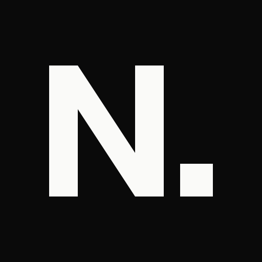
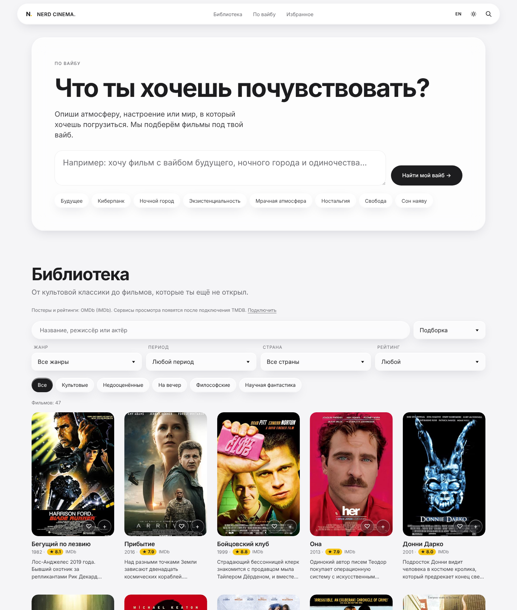

# NERD CINEMA.

Фильмы под твой вайб.

## Features

- Film library — поиск, жанры, периоды, страны, рейтинг, сортировка
- Vibe-based discovery — опиши атмосферу, получи подборку с объяснением
- Film details and watch providers — описание, вайб, похожие фильмы, где смотреть
- Personal watchlist — избранное и «Посмотреть позже» в localStorage
- Two languages — русский и English, light / dark theme

## Tech Stack

- HTML, CSS, vanilla JavaScript — без сборки и сервера
- Liquid-glass interface: backdrop-filter, no dependencies
- OMDb API — постеры и рейтинги IMDb (снимок в `assets/posters.json`)
- TMDB API (опционально) — доступность просмотра, свежие данные
- Локальный подбор по вайбу — словарь синонимов и метаданные фильмов
- GitHub Pages

## Live Demo

[sailxx.github.io/film](https://sailxx.github.io/film/)

---

Название меняется в одном месте: `assets/config.js` (`projectName`).(`projectName`).
Постеры и рейтинги: `OMDB_KEY=… node scripts/fetch-posters.mjs`. Без ключа TMDB нет сервисов просмотра.
